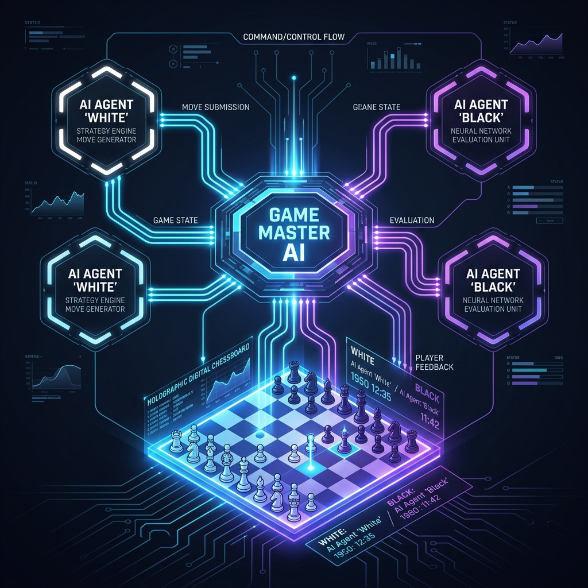

# ♜ ChessMate AI: Multi-Agent AI Chess Engine



## 📖 About the Project

ChessMate AI is an advanced, fully autonomous chess simulation where two cutting-edge Language Models (LLMs) battle against each other on a digital chessboard.

Unlike traditional chess engines (like Stockfish) that rely on brute-force search trees, this project explores **Agentic AI behavior**. The agents use **Microsoft's AutoGen** framework to hold a structured conversation, reasoning about their next moves in natural language. To interact with the physical game state, they rely on **strict LLM Tool Calling (Function Calling)** to trigger Python code that validates and executes their moves via the `python-chess` library.

The entire simulation is wrapped in a **Streamlit** frontend that renders the board dynamically in real-time, allowing users to watch the AI agents deliberate and execute their strategies live without waiting for the game to finish!

## ✨ Features

### Multi-Agent Architecture

- **Player White (Agent):** LLM-powered strategic decision maker
- **Player Black (Agent):** LLM-powered tactical opponent
- **Game Master (Proxy Agent):** Acts as the referee, executing tool calls, validating move legality, and monitoring the game state.

### Live Real-Time UI & Safety

- **Real-Time Board Rendering:** Watch the agents play live on the Streamlit dashboard as they execute moves without waiting for the game to finish!
- **Robust Move Verification:** The Game Master intercepts hallucinations and prevents illegal moves.
- **Dynamic API Routing:** Seamlessly supports modern Google Gemini models (`gemini-flash-latest`) via OpenAI compatibility wrappers to bypass tool-calling signature quirks.

---

## 🚀 How to Get Started (For Forked Repos)

If you have forked this repository to your own GitHub account, follow these exact steps to run it locally:

### 1. Clone your fork

Replace `<YOUR_GITHUB_USERNAME>` with your actual username:

```bash
git clone https://github.com/<YOUR_GITHUB_USERNAME>/chessmate_ai.git
cd chessmate_ai
```

### 2. Create a virtual environment (Recommended)

It is best practice to use a virtual environment so you don't clutter your global Python installation:

```bash
python -m venv .venv
# On Windows:
.venv\Scripts\activate
# On Mac/Linux:
source .venv/bin/activate
```

### 3. Install dependencies

```bash
pip install -r requirements.txt
```

### 4. Run the Application!

```bash
python -m streamlit run src/app.py
```

### 5. API Keys

Once the Streamlit app opens in your browser, you will need to input your API key in the sidebar. You can use an Groq, OpenAI key or a Gemini API Key.
